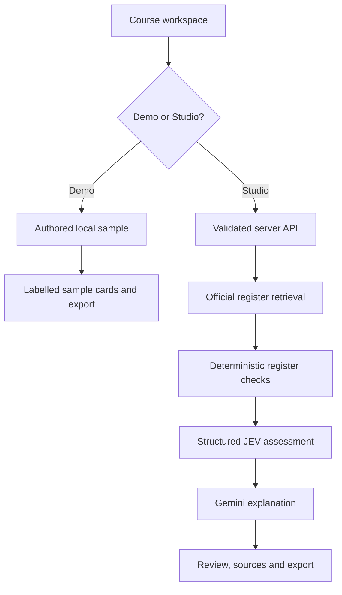

# EduNomad Course Compass — platform guide

Version: 1.0 · 23 October 2026 · Proposed Demo/Studio release

## Executive summary

Course Compass helps Australian training providers explore which units may suit a defined course objective and learner cohort. It brings the course brief, register material, suitability assessment and explanation into one review workspace. The immediate product value is a traceable shortlist that a course designer can inspect and challenge.

The application has two workspaces. **Demo** demonstrates the experience using one prepared leadership scenario and clearly labelled sample figures. It needs no API keys and makes no register or model requests. **Studio** retrieves current register content and uses two complementary AI steps: a structured assessment first, followed by an explanation grounded in that assessment and the retrieved material.

The platform is a research prototype. It does not approve a complete qualification, confirm an organisation's delivery scope or replace professional course-design judgement. A high suitability score does not establish compliance, and model confidence is not a validated prediction of success.

The next commercial milestone should be a bounded pilot with an experienced course designer. Measure time saved, unsupported recommendations, agreement with expert judgement and the effort required to review the output. Confirm production data access, commercial hosting entitlement and operating cost before expanding delivery.

This release proposes a mode switch, an environment template and documentation. Publication to the live application requires review and acceptance of the pull request. The documents distinguish implemented behaviour from work still required.

## Product scope

### Supported

- Qualification or skill-set lookup, current release and unit-grid exploration.
- A fixed objective and cohort for each review request.
- Up to four selected units, or a bounded agent shortlist from actual register results.
- Unit evidence retrieval, register checks, JEV assessment and a Gemini explanation.
- An inspectable process trail and Markdown export.
- Clearly labelled degraded results if one or both AI services are unavailable.
- A self-contained Demo with explicit sample provenance.

### Not implemented

Complete qualification assembly; exhaustive packaging-group and exclusion checking; imported-unit level validation; delivery-scope verification; student outcome prediction; user accounts; tenant isolation; persistent chat/history; billing; enforceable per-customer budgets; production-wide quotas; source-change monitoring; calibrated model quality benchmarks.

## How the workspaces operate

| Step | Demo | Studio |
| --- | --- | --- |
| Open | Local prepared brief and sample unit list | Retrieve the default qualification from the register |
| Adjust brief | Fixed scenario, visibly disabled fields | Change course code, objectives and cohort |
| Choose units | Prepared sample options | Actual qualification grid or verified search results |
| Review | Return an authored illustration | Retrieve evidence, check facts, evaluate, explain |
| Inspect | Sample content and fixed figures | Official sections, sources, releases and current evaluation |
| Export | Labelled Demo sample | Review with evidence and limitations |

Demo is a guided tour, not a free-form AI conversation. Its figures are authored examples and its sources list is empty. Studio never substitutes Demo data when a service fails. Switching modes clears the active workspace; changing the Studio brief clears the current conversation and result. A reload starts again using the configured default mode.

The switch is not an access-control system. Hiding live content behind the Studio option does not restrict direct API access. Use hosting authentication and, where appropriate, the separate shared access-key gate for a private pilot.

## Architecture

The application uses Next.js, React and TypeScript on a Node.js 24 runtime. The custom web route is the product entry point. Eve tool definitions expose reusable register-search and course-review actions for the optional agent runtime; they are not a second implemented product workflow.



### Studio request sequence

1. The browser sends the latest question, fixed course context, selected unit codes and at most ten prior messages to `POST /api/chat`.
2. The server applies access checks, origin checking, request bounds and schema validation.
3. It retrieves the qualification and official unit grid. If no units are selected, a Gemini tool agent can shortlist at most four codes from the grid or actual search results. This planning step occurs before the assessment.
4. It retrieves the units' application, criteria, foundation skills and assessment sections, and checks currency, grid membership and prerequisite availability.
5. JEV assesses objective fit, cohort fit, evidence sufficiency and the supporting evidence section. Its output is validated before use.
6. Gemini receives the fresh assessment and official content to explain the recommendation, gaps and next checks. The assessment precedes this final explanation.
7. The server returns one JSON result containing the reply, assessment and process trail. The browser updates both the conversation and evidence panel. Responses do not stream token by token.

The planner and the final explanation are separate Gemini tasks. “JEV before Gemini” in this product means JEV precedes the final explanation; it does not mean that the optional planning call happens after JEV.

### Main implementation modules

| Module | Responsibility |
| --- | --- |
| `app/page.tsx` | Reads only the default mode and renders the workspace |
| `app/_components/course-compass.tsx` | Browser interactions, state, mode switch, cards and export |
| `lib/workspace-mode.ts` | Validates the initial Demo/Studio choice |
| `lib/demo.ts` | Authored samples with explicit sample provenance; no service calls |
| `app/api/register/route.ts` | Protected register lookup and search |
| `app/api/chat/route.ts` | Protected, bounded review request |
| `lib/contracts.ts` | Input schemas and shared result types |
| `lib/training.ts` | Official API adapter, content retrieval and short cache |
| `lib/rules.ts` | Deterministic checks, separate from suitability |
| `lib/jev.ts` | TypeSafe-compatible Gateway evaluation and strict result parsing |
| `lib/review.ts` | Live workflow, planning, explanation and explicit failure handling |
| `lib/http.ts` | Shared access key, origin/rate checks and safe errors |
| `agent/tools/` | Reusable Eve search/review definitions |

## Data and assessment semantics

### Register access

The adapter uses structured JSON endpoints documented through the official register's Swagger interface. It does not scrape rendered pages. It retrieves training components, current releases, content bundles, unit grids, prerequisites and search results from a fixed official host.

Records carry retrieval time, release information and official links. The cache lasts five minutes per process. A failed prerequisite request is distinct from a verified empty prerequisite list. Public endpoint availability does not, by itself, establish commercial support, permitted reuse, service levels or rate-limit guarantees; confirm the supported integration arrangement before selling the service.

### Assessment outputs

| Output | Interpretation |
| --- | --- |
| Objective fit | A 0–4 rubric score normalised to a 0–100 index |
| Cohort fit | A separate rubric index against the described cohort |
| Native confidence | Model-provided confidence; not calibrated for this service |
| Evidence sufficiency | A JEV Noul result used to withhold poorly grounded fit values |
| Supporting section | A Choice result constrained to retrieved section IDs or “none” |
| Register status | Deterministic core/listed/unlisted classification, independent of fit |

The parser validates score ranges, probability distributions, confidence and source IDs. A sufficiency result below 0.75 or missing supporting section withholds fit. Recommendation labels combine fit, confidence, sufficiency and blockers; they are discussion aids, not eligibility decisions. An unlisted unit requires importing review rather than automatic acceptance or rejection. Core requirements remain compulsory irrespective of a low suitability score.

The product's evidence sufficiency threshold and recommendation logic require expert evaluation. They are implementation choices, not regulatory thresholds or validated scientific cut-offs.

## Environment configuration

The current application uses **AI Gateway** for both model services. Configure the variables actually read by this code; direct provider credentials would require a separate integration change. Private values are intentionally blank in `.env.example` and `config/vercel-environment.example.json`.

| Variable | Classification | Template value | Purpose |
| --- | --- | --- | --- |
| `COMPASS_DEFAULT_MODE` | Non-sensitive config | `demo` | Initial workspace: `demo` or `studio`; invalid/missing values select Demo |
| `GEMINI_MODEL` | Non-sensitive config | `google/gemini-3.8-flash` | Planning and explanation model ID |
| `JEV_MODEL` | Non-sensitive config | `typesafe-ai/jev-1.14.0` | Structured evaluation model ID |
| `AI_GATEWAY_API_KEY` | Private | Blank | Optional server-side Gateway credential; hosted OIDC can be used instead |
| `COMPASS_ACCESS_TOKEN` | Private | Blank | Optional shared key for Studio APIs; blank disables this app-level gate |
| `VERCEL_OIDC_TOKEN` | Platform-managed private value | Do not create manually | Short-lived hosted authentication when provided by the platform |

No variable in this template uses a browser-public prefix. The default mode is the only configuration passed to the browser by the page. A mode change does not change deployment configuration or security policy.

### Hosted setup

1. Select this application's hosting project and check its linked repository. Do not apply this template to another application.
2. Review existing variable **names and scopes** before adding missing entries. Preserve existing real values. The JSON file is a template, not an instruction to overwrite secrets with blanks.
3. Add the three non-sensitive settings for Production, Preview and Development as appropriate. Keep their values consistent during this pilot unless a deliberate environment difference is needed.
4. Leave private fields blank until the service owner enters the appropriate values through the hosting dashboard. Store real values as secrets; use separate development credentials and avoid sharing production credentials with previews.
5. If hosted OIDC is available and entitled to use Gateway, the API-key field may remain empty. Confirm Gateway access and credits through a real Studio request. Never set a dummy API key: a non-empty invalid value can take precedence over OIDC.
6. An optional shared access key must be a real private value to enforce the gate. A blank field provides no gate. This key is not per-user authentication or a substitute for tenant isolation.
7. Hosting environment changes apply to new deployments. Apply the approved release and verify its effective mode and service behaviour. Do not enable auto-merge or skip review.

**Current setup limitation:** the connected hosting integration did not expose this application's running project during preparation. No hosted variable creation is claimed. The environment template and code are ready for review; the correct project must be accessible to complete hosted configuration.

### Local setup

```bash
npm ci
cp .env.example .env.local
npm run dev
```

Node.js 24 is required. Demo works with the private fields blank. For live local AI, enter this application's own Gateway credential into the ignored local file or use the platform's supported local OIDC workflow. Do not paste keys into source, design tools, issues, pull requests or chat.

The environment template is committed; `.env.local`, platform link files and dependency/build directories are ignored. A pulled environment file can overwrite an existing local file; back up private local configuration securely before pulling. Hosted secrets may not be returned by a pull.

## API and failure behaviour

| Interface | Behaviour |
| --- | --- |
| `GET /api/register?code=...` | Retrieve a product by validated code |
| `GET /api/register?q=...` | Search the official register |
| `POST /api/chat` | Review the submitted context and up to four units; optional bounded history |
| 401 | Shared access key required; browser offers a password field |
| 400 | Invalid request/schema or malformed JSON |
| 413 | Chat request exceeds the route's body bound |
| 429 | Per-process review limit reached; retry guidance returned |
| 502 | Upstream/processing request failure with a filtered message |

No selected units plus missing AI access prevents autonomous shortlisting; the user can select units to obtain evidence independently. If JEV fails, fit scores are withheld and the result explains the missing assessment. If Gemini fails, an evidence summary is returned. A successful API response can therefore contain a deliberately degraded review; inspect evaluator status and reply type, not only HTTP status.

## Privacy, security and retention

- Conversations, course context, results and any shared access key live in browser memory. Refreshing or switching modes clears the workspace. The application has no persistent conversation database.
- Studio sends the course brief, question, bounded history and retrieved evidence to its server. Model calls send the relevant content to the configured Gateway/provider route. Use de-identified pilot material and establish appropriate processing arrangements before handling restricted information.
- API credentials remain server side. Demo contains no keys, private records or personal names.
- The shared access-key check uses timing-safe comparison. POST requests have an origin check. Register hosts are fixed; the adapter bounds requests and converts official HTML into inert text.
- Rate limiting is per process. It is not a durable spend cap or distributed abuse defence. Exported reviews are created in the user's browser; they can include the user's own entered brief and conversation content.
- Hosting/provider logs and retention are outside browser-memory behaviour. Review those separately; the absence of an application database does not guarantee zero provider retention.

## Operating model and release process

An operator maintains service access, hosting and model configuration. A course designer defines the brief, reviews the evidence, performs remaining compliance checks and owns the final course decision. Product stewardship should track service quality, unsupported recommendations and review effort.

Changes should be prepared on a feature branch, validated and submitted as a pull request. Review the changes and preview before accepting the merge. Do not merge automatically. Environment changes also require an explicit change record; keep real values out of that record.

For each accepted release, check Demo without credentials; switch to Studio; verify an official product load; test an authorised review; inspect evaluator/source information; test a degraded result; export a review; and inspect mobile layout. A successful build does not prove model access or output quality.

## Cost and capacity

Demo does not call paid AI or register services. Studio can make a planning call, a structured JEV call and an explanation call, depending on the selection. Up to four units and bounded history help constrain request size, but they do not implement customer budgets. Provider balances, Gateway credits and hosting usage are separate operational concerns. Verify actual account terms and use before estimating a paid service margin.

Gateway model IDs can change. Confirm supported IDs, entitlement, pricing and model behaviour before adopting a new default. Do not automatically upgrade hosting or enable paid services as part of this release.

## Validation and known gaps

Run `npm run verify` for TypeScript, focused tests and the production build. `npm run test:register` separately exercises the live official adapter. The tests cover deterministic rules, malformed/unsupported evaluator output, request bounds, shared access control and Demo sample provenance.

Live Gemini/JEV operation and deployed end-to-end behaviour require the correct application's service access. A complete qualification-compliance engine, durable quotas, user management, calibrated evaluation, operational monitoring and comprehensive accessibility verification remain future work. See the pull request for the checks actually completed for this release; do not infer a passed live check from these instructions.

## Suggested product sequence

| Stage | Outcome | Evidence needed to proceed |
| --- | --- | --- |
| Guided demonstration | Stakeholders understand the review journey | Clear distinction between samples and live outputs |
| Expert pilot | A traceable shortlist saves review effort | Expert agreement, error examples and measured time saved |
| Operational readiness | Real users can be served reliably | Supported data access, identity, quotas, monitoring and cost model |
| Broader product | Repeatable value across courses and cohorts | Validated quality, viable unit economics and support capability |

## Public technical references

- [Official register API documentation](https://training.gov.au/swagger/index.html)
- [Official register integration guidance](https://training.gov.au/support/connecting-your-system-traininggovau-apis-1)
- [AI Gateway documentation](https://vercel.com/docs/ai-gateway)
- [Hosting environment variables](https://vercel.com/docs/environment-variables)
- [Next.js environment variables](https://nextjs.org/docs/app/guides/environment-variables)

These are reference entry points. Service terms and provider features must be checked at the time of production adoption.
