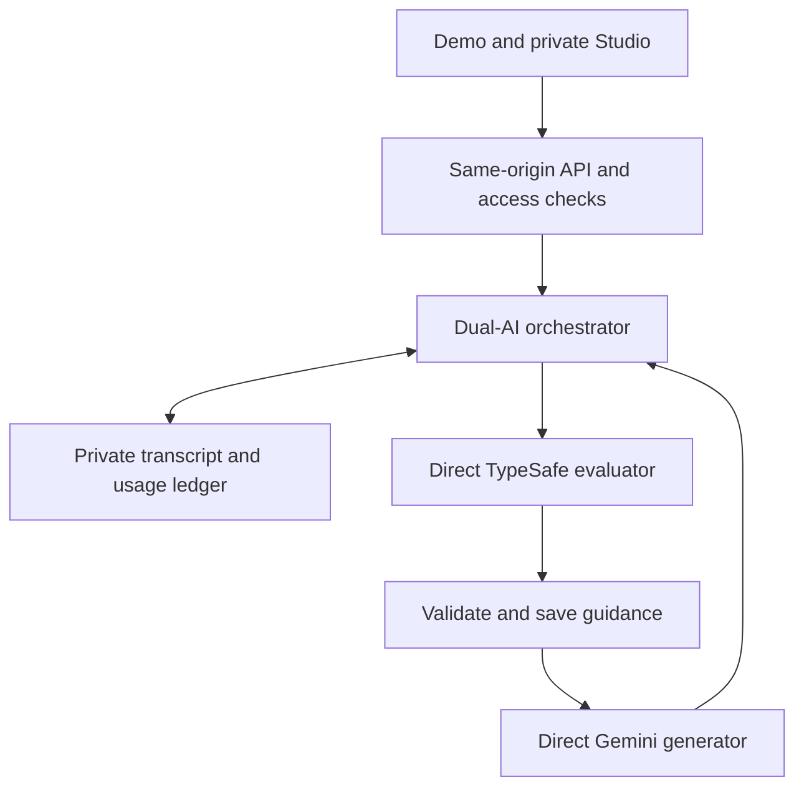

# EduNomad Course Compass platform reference

Version 3.1 · 23 October 2026 · Direct-provider Studio

## Executive summary

Course Compass helps a course designer compare official units of competency with a clear course brief. It supports research and professional judgement; it does not approve a qualification or replace an RTO's compliance review.

**Demo** is a prepared, clearly labelled sample with no external requests. **Studio** uses official register evidence and two separate AI providers. JEV evaluates the evidence against the current brief first. Gemini receives only the validated current guidance and writes the explanation. If evaluation fails or is invalid, generation stops and the workspace shows an evidence-only result with no substitute fit scores.

Studio now uses direct provider APIs and server-managed credentials. A private application access code opens the shared pilot workspace; it is different from either provider key. The supplied architecture is implemented through separate orchestration, provider, Studio-shell, authentication, persistence and accounting modules.

A server ledger controls an internal workspace allowance. It reserves a conservative amount before paid work, records actual reported token usage and releases unused allowance. The interface shows percentage and status, keeping monetary details private. This is an estimated internal allowance, not the balance in either provider account.

Requests and replies are durable. Repeating a completed request ID returns its saved result. An unclear network outcome offers status recovery and can retain a cost hold until the operator reconciles it. A separate, optional evaluator action can assess a saved reply without rewriting it.

The observed user request completed JEV evaluation and recorded its native usage, then Gemini exceeded the application's 60-second response timeout without returning a usage receipt. The usage block has been cleared through an audited upper-bound internal allowance adjustment. Actual Gemini invoice usage remains unknown. No new paid request was made during this repair.

The timeout and recovery update is a release candidate awaiting review. It passes type checks, 43 deterministic tests, a model-free build and rollback-only database recovery checks. A longer response window reduces premature client cancellation; it does not guarantee provider availability. End-to-end Gemini success remains unverified.

## User journey

1. Explore Demo without an application key or a paid request.
2. Choose Studio and enter the shared application access code. The server checks every private route; missing access configuration fails closed.
3. Set the qualification, objectives and cohort. Select up to four units, or begin with a deterministic shortlist from the qualification's official grid.
4. Submit an explicit review. The server admits the operation only after access, version, configuration and allowance checks.
5. Read the saved explanation, fit cards, source evidence and Workflow diagnostics. Missing assessment is labelled precisely.
6. Use **Recover status** after an uncertain response. This reads the operation; it does not resubmit it to a model.
7. Optionally choose **Assess saved reply**. This uses a separate evaluator call and allowance reservation. The answer remains unchanged.
8. Use **Lock Studio** or switch to Demo to clear the access code from memory.

Opaque identifiers for an unresolved operation are retained in tab-scoped session storage for recovery after re-authentication. Provider keys, application access codes, prompts and replies are not stored there. The visible conversation resets when the workspace is left; server transcript and accounting records remain durable.

## System architecture

The host runs on Next.js with a Node.js server runtime. Vercel is the deployment host. Model traffic goes directly to TypeSafe and Google; there is no AI routing intermediary, OIDC model authentication or AI SDK/Eve runtime. Legacy session pages redirect to the main workspace.

The persistence adapter calls an authenticated HTTPS bridge in the application's isolated Supabase project. That bridge exposes an allowlisted accounting API and uses its built-in server credential to call a restricted PostgreSQL RPC. It does not proxy arbitrary SQL or AI requests. Only a hash of its separate application-server credential is included in its deployment configuration; the plaintext credential stays in the host's secret environment.

## Module boundaries

| Module | Responsibility | Application-specific knowledge |
| --- | --- | --- |
| `packages/dual-ai-core` | Typed sequencing, admission, attempt creation, receipt settlement, validation and saved-result recovery | None; host supplies policies |
| `packages/provider-adapters` | Direct TypeSafe/Gemini requests, bounded transport and native usage normalisation | Vendor schemas only |
| `packages/usage-ledger` | Versioned model/rate registration, precise costs, conservative ceilings and public usage contract | Supported deployment model registrations |
| `packages/shared-persistence` | `OperationStore` implementation and server-selected environment scope | No course rules |
| `packages/shared-auth` | Timing-safe application-code verification and closed access states | No course rules |
| `packages/studio-shell` | Configurable Studio entry, mode selector and usage display | Host supplies branding and description |
| `lib/review.ts`, `lib/jev.ts`, `lib/rules.ts`, `lib/training.ts` | Course evidence, fit rubric, guidance projection and official-register rules | Course Compass domain policy |
| `lib/studio.ts`, `app/api` | Validated product requests, current host configuration and safe responses | Product transport |
| `supabase/migrations`, `supabase/functions` | Durable tables, atomic operations and authenticated persistence bridge | Private single-tenant pilot |

These are source modules in one repository, not separately published packages. A new host can replace the policy and `OperationStore`; adding another model requires an adapter, validated usage semantics and an explicit rate registration. It is not enabled merely by changing an environment string.

## Turn and state contracts

`POST /api/ai/turn` accepts `requestId`, `conversationId`, `expectedVersion`, `message`, fixed course context and at most four unit codes. All identifiers are validated UUIDs. A stable server hash covers immutable domain inputs and the expected version. Browser-supplied history never replaces saved messages.

The server pins models, adapter/schema versions, prompt-policy versions and rate cards at admission. It locks the environment workspace, checks available allowance and records the operation before model work. Provider attempts have independent UUIDs and are written before outbound requests. Model A's native result is mapped to validated domain guidance before Model B can run.

The complete transcript is stored separately from working context. Only the latest ten saved messages, each bounded to 7,000 characters, enter a turn's working context. Official evidence is freshly retrieved for each new review. Prior scores are not reused as current evidence or substituted for the actual transcript.

A reply and its two transcript messages commit atomically with one conversation-version increment. A repeated ID with the same hash returns the existing result; different content using that ID is a conflict. Another worker cannot admit a concurrent paid operation against the same environment workspace. Different environments use separate records.

## Provider contracts

| Role | Native provider model | Direct endpoint | Output handling |
| --- | --- | --- | --- |
| Evaluator | `jev-1.14.0` | `https://api.typesafe.ai/v1/systemone` | Score, Choice and Noul answers; confidence and probability distributions validated; actual source references required |
| Generator | `gemini-3.8-flash` | Google `models/...:countTokens` then `models/...:generateContent` | Token preflight; bounded output; complete visible reply required; thought text excluded |
| Post-reply assessor | Same pinned evaluator registration | TypeSafe endpoint | Separate Noul insights about the saved exchange; never updates its reply |

The deterministic research shortlist uses verified official grid codes and title terms. It is a starting point, not suitability scoring. Imported units can be selected explicitly and retain importing-review warnings. Current official-register integration is a prototype adapter; supported commercial access and reuse still require confirmation.

Fit indices are rubric values normalised to 0–100. They are neither compliance probabilities nor calibrated guarantees of learner outcomes. A core unit remains compulsory regardless of its fit score. Missing evidence, native answer validation failure or missing supporting sections cannot produce an invented fit score.

## Usage and credits engine

The private relational ledger stores environment workspaces, allocations, conversations, operations, messages, model attempts, immutable charges, reconciliation entries and independent assessments. Every relevant record is scoped to the pilot tenant and environment. This is a single-tenant shared pilot, not a released multi-customer tenancy system.

Costs use USD nanodollars, with one USD represented by 1,000,000,000 internal units. Calculation uses checked token quantities and `BigInt`; precise amounts cross internal JSON boundaries as strings. Public responses contain percentages and status only.

Gemini prompt usage includes cached input. The normaliser charges cached input once, and accounts for both response and thinking tokens. Unsupported tool-use or inconsistent token totals fail reconciliation checks. TypeSafe currently charges input tokens; output usage remains recorded even where its registered rate is zero. The selected rate card is saved for each attempt. New announced rates affect newly admitted operations; they do not rewrite existing receipts.

The conservative reservation covers evaluator and generator envelopes. Realised usage settles the relevant portion before model output is interpreted. Therefore a parsing failure still retains its known charge. Network ambiguity or a missing usable receipt retains a possible-cost hold; the app never assumes a browser timeout means no charge occurred. Unstarted stages are released when a degraded reply commits.

Available allowance is allocation minus known charges, audited reconciliation adjustments and active holds. Adjustments can be verified additional costs or clearly labelled conservative upper bounds for an unrecoverable provider outcome. A positive percentage can still be insufficient for a conservative full-turn reservation. Percentage may rise after a hold is released. An exhausted, unassigned, unavailable or review-required account cannot start another paid operation.

## Private access and safe projections

The same-origin API verifies the application code on register, workspace, turn, independent-assessment and recovery routes. Constant-time comparison is used. POST requests have origin, size and process-local rate guards. Database admission provides the durable single-workspace concurrency and allowance controls.

Provider keys never reach the browser or prompts. Ordinary responses omit monetary amounts, rates, provider response IDs, raw receipts and backend credentials. The bridge has its own server-only bearer credential and verifies its hash; disabling JWT verification for that function does not disable its application authentication. The PostgreSQL RPC is `SECURITY INVOKER`, with execution denied to browser roles. Private tables have RLS and explicit privileged-backend policies, with no browser grants.

The existing pilot access code remains supported through the `COMPASS_ACCESS_TOKEN` compatibility alias when `STUDIO_ACCESS_TOKEN` is absent. No credential is copied from another product. Hosting protection remains independent of the app code.

## Environment configuration

All secrets are server-only. See `.env.example` and `config/vercel-environment.example.json`; neither contains real credentials or infrastructure identifiers.

| Variable | Purpose |
| --- | --- |
| `COMPASS_DEFAULT_MODE` | Initial Demo or Studio view; does not authorise access |
| `STUDIO_ENABLE_LIVE` | Explicit paid-request gate; disabled by default |
| `STUDIO_ACCESS_TOKEN` | Application access code; compatibility alias described above |
| `EVALUATOR_PROVIDER`, `EVALUATOR_MODEL`, `TYPESAFE_API_KEY` | Direct evaluator configuration |
| `GENERATOR_PROVIDER`, `GENERATOR_MODEL`, `GEMINI_API_KEY` | Direct generator configuration |
| `GENERATOR_BILLING_TIER` | Verified standard paid rate registration |
| `STUDIO_LEDGER_URL`, `STUDIO_LEDGER_TOKEN` | Server-only authenticated persistence adapter |
| `TENANCY_MODE` | Supported value `single-workspace`; other values fail closed |
| `ENABLE_POST_REPLY_ASSESSMENT` | Optional, explicit extra evaluator action |
| `ENABLE_ADMIN_PROVIDER_SETTINGS` | Remains false; browser key administration is not implemented |

The supplied template's session-signing secret, secret-manager reference and direct database URL are unnecessary for this memory-only access-code strategy and HTTPS persistence adapter. They are not presented as active controls. Budget configuration is an audited ledger allocation, not a mutable environment balance. Provider keys are stored separately, exactly as supplied; validity is unverified without a separately authorised live check.

Production has its own allowance record. Preview and Development remain separately disabled and unallocated. Before future live Preview work, provision explicit test credentials and an isolated allowance. A Preview request cannot use Production ledger records through a client-supplied workspace ID.

## Endpoint map

| Endpoint | Operation | Model call |
| --- | --- | --- |
| `GET /api/workspace` | Access check and safe usage projection | None |
| `GET /api/studio/snapshot` | Alias for the workspace projection | None |
| `GET /api/studio/usage` | Safe usage-only projection | None |
| `GET /api/register` | Official evidence retrieval after access check | None |
| `POST /api/ai/turn` | Evaluator → validated guidance → generator | Explicit admitted operation only |
| `POST /api/chat` | Compatibility alias for the same guarded turn handler | Same ledger contract |
| `POST /api/ai/assessment` | Independent evaluation of a committed exchange | Evaluator only |
| `GET /api/ai/operations/:id` | Recover safe status/result | None |

There is no unauthenticated model route or browser-facing allocation, key-rotation or reconciliation API. The unlock screen verifies the code through the workspace endpoint; it does not create a cookie session. Operator-only procedures are documented in `docs/operations.md`.

## Recovery and operations

A recoverable result is read by operation ID and authorised environment. Unknown or pending results are never automatically submitted again. If cost is uncertain or a worker stops mid-operation, new paid requests remain blocked until the operator reviews provider reporting and records a reconciliation. Existing known charges remain immutable.

The private operator-only reconciliation procedure accepts an additional allowance adjustment, evidence/reason and operator reference. Prefer verified additional cost; if the native outcome cannot be recovered, the operator may retain the full frozen unresolved attempt ceiling as an explicitly labelled upper-bound adjustment. That preserves the cap without asserting an invoice amount or a zero-cost outcome. It records an adjustment, resolves uncertain attempts and releases the hold. Ordinary Studio users and the bridge cannot invoke it. Duplicate reconciliation of a resolved operation is rejected.

Shared-code access does not identify an individual. Individual authentication, revocable sessions, customer roles, tenant routing, self-service administration, automated invoice reconciliation, retention automation and operational alerting remain future work. Records currently persist until an authorised operator applies a retention/deletion process; automatic expiry is not configured. These limits are explicit rather than described as production-ready capabilities.

## Verification and evolution

`npm run verify` checks types, deterministic tests and a production build. The test preload disables networking; provider transports are synthetic. Builds contain no live-model check. `tests/ledger.sql` exercises real transaction logic using rolled-back fixtures. Separate bridge and concurrency checks make no AI request.

The current recovery record is `docs/quality/2026-10-23-studio-recovery.md`; the initial migration record is `docs/quality/2026-10-23-direct-providers.md`. Earlier Gateway observations remain historical evidence and are not connectivity results for this architecture. No new provider output, model quality, latency benchmark or invoice reconciliation is claimed from mock tests.

## Practical Studio test case

Use [the complete Studio test guide](docs/quality/STUDIO-TEST-GUIDE.md) for exact UI options, field values, two copy-and-send messages, expected Workflow states, optional independent assessment and a run record. Its case is **BSB40120 Certificate IV in Business**, comparing **BSBCRT411 Apply critical thinking to work practices** with **BSBTEC404 Use digital technologies to collaborate in a work environment**. It exercises everyday decisions and remote collaboration, distinct from the leadership Demo.

The qualification grid, unit currency and prerequisite lookups were retrieved from the official register on 23 October 2026. This confirms the scenario's source records, not its suitability scores or complete qualification compliance. The PLATFORM document's **Test guide** tab contains the same operating instructions.

## Timeout and failure contract

Gemini token counting is bounded to 15 seconds; generation is bounded to 120 seconds without automatic retry. The turn routes allow 300 seconds for the complete sequence and persistence. An admitted worker is stale after six minutes, leaving a margin beyond the route budget. The longer window requires the accompanying ledger migration; it was tested transactionally and is not yet applied in Production.

A failed token-count preflight proves that no generation request was sent. Its attempt is rejected and released, while any already settled evaluator usage remains charged. A timeout after generation is sent, or an unusable usage receipt, still retains an uncertain hold. Failure logs contain opaque operation/attempt IDs, role, stage, safe category and HTTP status only; they exclude prompts, provider bodies, keys and amounts.

## Feedback on the supplied method

The strongest design choices are explicit evaluator-to-generator state transfer, separate provider adapters, receipt-first accounting and independent post-reply analysis. They make failure cases reviewable and prevent an explanation from silently depending on stale evaluation.

Conservative reservations deliberately trade some utilisation for cost control. Recovery needs both saved operations and a usable operator reconciliation path; a retry button alone would be insufficient. The optional final evaluation is an extra paid operation, so the UI makes that choice explicit.

The reusable modules now separate domain policy from transport and accounting. The remaining boundary is product maturity: a private shared pilot can exercise the method, while a customer-facing multi-tenant product still requires individual identity, permissions, retention operations and reconciliation against real provider receipts. Live model validation is the next evidence-gathering step when authorised.

## Official technical references

- [TypeSafe API](https://docs.typesafe.ai/api/system-one) and [model/pricing reference](https://docs.typesafe.ai/models).
- [Gemini generation API](https://ai.google.dev/api/generate-content), [token counting](https://ai.google.dev/api/tokens) and [pricing](https://ai.google.dev/gemini-api/docs/pricing).
- [Supabase database functions](https://supabase.com/docs/guides/database/functions) and [Edge Functions](https://supabase.com/docs/guides/functions).

Provider documentation and text pricing were checked on 23 October 2026. Revalidate the registry before expanding supported models or modalities.
